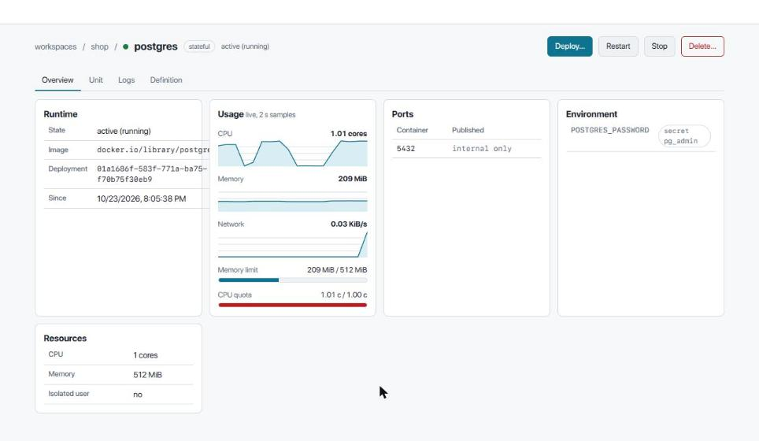
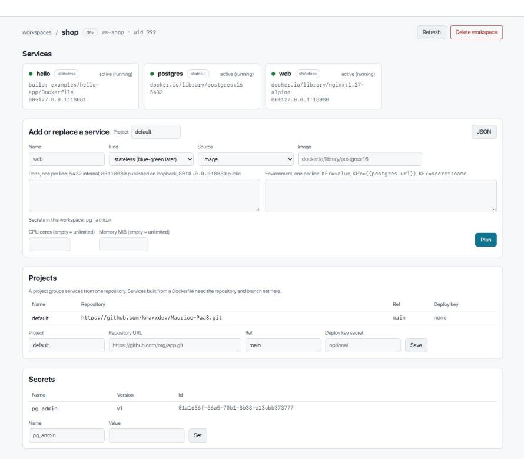

<div align="center">

# Maurice PaaS

**A self-hosted deployment panel for one powerful server, built on rootless Podman.**

[](LICENSE)
[](https://github.com/kmaxxdev/Maurice-PaaS/wiki/Roadmap)
[](https://github.com/users/kmaxxdev/projects/1)
[](https://github.com/kmaxxdev/Maurice-PaaS/wiki)

</div>

Maurice (friends call it *Marik*) gives you the convenience of Coolify on a single
bare-metal server where blockchain nodes, ClickHouse, databases and application
services live side by side. It is not Docker with a different runtime underneath.
It is built around what Podman does well: rootless isolation by Unix user,
Quadlet and systemd as the lifecycle engine, auto-update with rollback, native
secrets.

> **Status: Alpha.** Workspaces, services from images or Dockerfiles, secrets,
> plans with apply, logs, live stats and a web UI work end to end on a real Podman
> host. Not for production yet: no proxy, TLS, auth or backups before MVP. The
> [Alpha guide](https://github.com/kmaxxdev/Maurice-PaaS/wiki/Alpha-Guide) shows
> everything that works; progress is on the [task board](https://github.com/users/kmaxxdev/projects/1).



## What works today

- **Workspaces** as system users with their own subuid range, home, network and `systemd --user`; deleting one leaves nothing behind.
- **Services** from an image or from a Dockerfile in a git repository, rendered to Quadlet units; stateful services get a volume, every service a stable DNS name inside its workspace.
- **Plan / apply** for every change, with the unit diff shown before anything is written and a confirmation step for destructive plans.
- **Secrets** encrypted at rest, delivered through `podman secret`, never written to units or logs.
- **Closed ports by default**; publishing binds to `127.0.0.1` unless told otherwise, and host port clashes across workspaces are refused.
- **Deploy** waits for the health check; **restart**, **stop**, **logs** with follow, **live CPU, memory and network**, the unit file on disk.
- **Reboot-safe**: deployed services come back on their own.
- **Web UI** embedded in the single binary, plus the `marik` / `maurice` CLI with the same capabilities.



## Quick start

```
sudo install -m 0755 maurice /usr/local/bin/maurice      # from `cargo build --release`
sudo ln -sf maurice /usr/local/bin/marik
sudo maurice host prepare                                # PostgreSQL, keys, journald, maurice.service
sudo systemctl enable --now maurice                      # panel on 127.0.0.1:7700

marik workspace create shop && marik plan apply <plan-id>
```

Full walkthrough, CLI reference and known limits: the
[Alpha guide](https://github.com/kmaxxdev/Maurice-PaaS/wiki/Alpha-Guide).

## Why another panel

| The pain | What Maurice does about it |
|---|---|
| Ports exposed by default, closed by hand | Nothing is published until you tick a box. A port lives inside the workspace network until then. |
| `docker.sock` access equals root on a host full of keys | Every workspace is its own system user running rootless Podman. One compromised project cannot reach the others or the host. |
| Hand-copied configs, typos in env, port clashes | The panel generates Quadlet units from a validated model. Env references like `{{postgres.url}}` are resolved for you. |
| Admin DB credentials in every service | Database roles (admin / app / readonly) with rotation that restarts the dependents. |
| Logs filling the disk | journald with limits, searchable in the UI. |
| Agents that can wreck prod | Plan / apply. Anything an agent or external client proposes is a plan a human confirms. In prod, always. |
| Development tied to a laptop | Dev workspaces on the server: SSH, tmux, Neovim, Claude Code, code-server. The laptop can reboot. |

## How it works

```
User / Claude Code / Telegram
        │
        ▼
  UI + API + MCP            tokens scoped read / plan / apply
        │
        ▼
  Control plane             generates Quadlet units, change plans, Caddy config
        │
        ▼
  Agent ── machinectl ──▶  ws-<project>   rootless Podman + systemd --user
        │                    ├─ web@.service        stateless, blue-green
        │                    ├─ postgres.service    stateful, restart + backups
        │                    └─ <project>.network   DNS by service name
        ▼
  Caddy admin API           domain ──▶ 127.0.0.1:<port>, TLS, graceful switch
```

Files on disk stay the source of truth: every unit the panel writes can be read,
diffed and applied with plain `systemctl`. The panel is a convenience layer, not
a runtime dependency.

## Roadmap

| Stage | Purpose | Status |
|---|---|---|
| **Alpha** | Panel → agent → Quadlet → rootless Podman works on a real server. Workspaces, deploy from image or Dockerfile, logs, networks, secrets, validator. | **done, testing on real projects** |
| **MVP** | Fit for production. Caddy with TLS, blue-green deploys, registry, webhooks, service catalogue, Telegram alerts, S3 backups, telemetry, auth. | — |
| **Beta** | Full feature set. MCP server, built-in agent, remote dev workspaces, Cloudflare tunnels, log triage, Plane tracker. | — |
| **Release** | Stabilisation. Docs, upgrade procedure, Podman compatibility matrix, regression tests. | — |

Scope, done criteria and risks for every stage are in the
[Roadmap](https://github.com/kmaxxdev/Maurice-PaaS/wiki/Roadmap).

## Stack

Rust for the control plane and agent, one static binary · Podman 5 with crun,
netavark and aardvark-dns · systemd + Quadlet · PostgreSQL · ConnectRPC API ·
SolidJS SPA embedded in the binary · Caddy · VictoriaMetrics and VictoriaLogs ·
restic + rclone · Ubuntu 26.04 LTS host, Fedora and Debian 13 as secondary targets. Every choice
has a record in [`docs/decisions/`](docs/decisions/) and the reasoning in the
[Technology Stack](https://github.com/kmaxxdev/Maurice-PaaS/wiki/Technology-Stack).

## Learn more

- [Wiki](https://github.com/kmaxxdev/Maurice-PaaS/wiki): the full plan, architecture, data model, prior art, telemetry, remote development.
- [Task board](https://github.com/users/kmaxxdev/projects/1) and [issues](https://github.com/kmaxxdev/Maurice-PaaS/issues): what is being worked on right now.
- [`docs/`](docs/): architecture decision records and working notes, versioned with the code. Opens as an Obsidian vault.
- [Contributing](https://github.com/kmaxxdev/Maurice-PaaS/wiki/Contributing): language, commit format, branch workflow.

## License

[Apache 2.0](LICENSE). Maurice stands on the shoulders of
[Coolify](https://github.com/coollabsio/coolify),
[Rookery](https://github.com/rookerylabs/rookery), Podman, Caddy and systemd.
